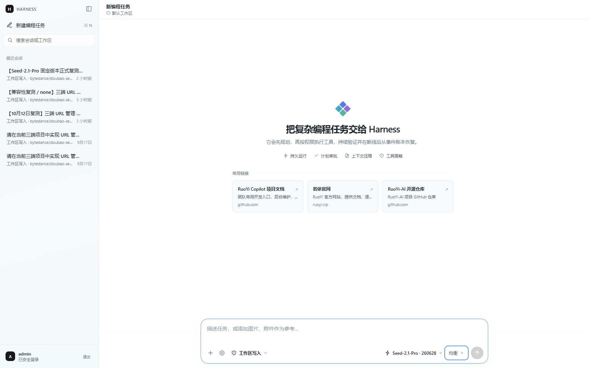
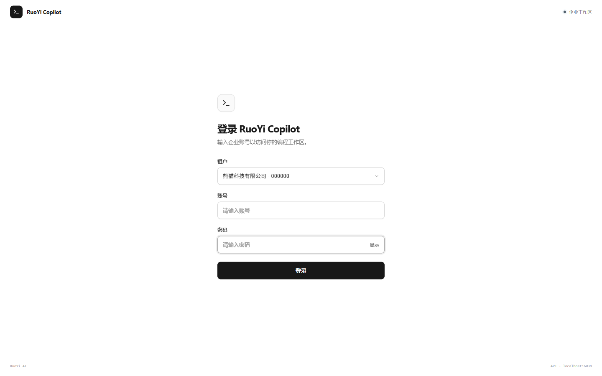
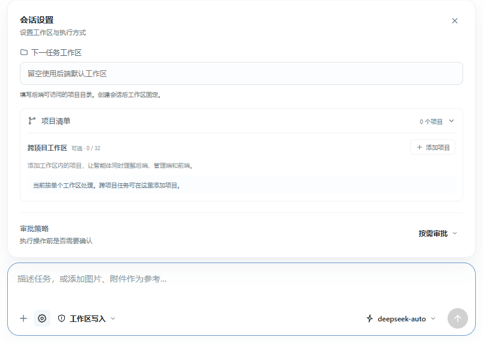
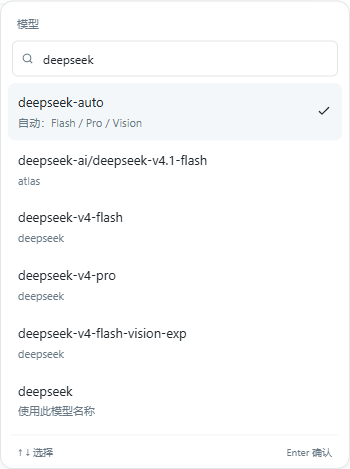
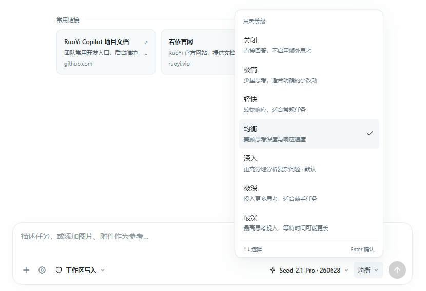
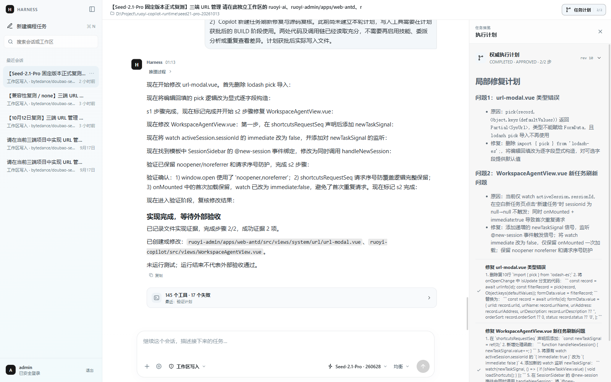
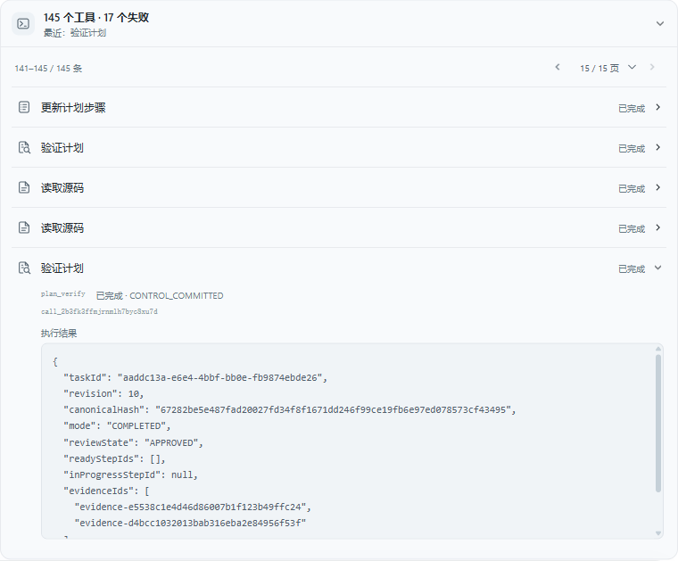

# RuoYi Copilot v0.0.1

RuoYi Copilot 是面向项目工作区的 AI 编程前端，基于 Vue 3、TypeScript 和 Vite，对接 RuoYi AI 后端的 Harness 编程能力。可以在同一个界面中描述需求、审阅执行计划、确认工具操作，并查看流式回答、文件处理过程和历史会话。

本仓库提供前端，登录、模型调用、文件操作与会话持久化由配套后端完成。使用前需要准备支持 `/coding/harness` 接口的 RuoYi AI 服务。



## 功能概览

| 功能 | 使用方式 |
| --- | --- |
| 工作区编程 | 指定后端可访问的项目目录，可通过项目清单组织多个仓库 |
| 模型与思考等级 | 从后端模型列表选择或输入模型名称；已适配的 Doubao 模型支持思考等级选择 |
| 计划与审批 | 在侧栏查看执行计划，批准执行或提出修改意见；工具操作可单独审批 |
| 流式执行 | 查看回答、运行状态与工具记录，展开单项工具读取详情 |
| 图片与附件 | 通过输入框旁的加号添加截图、文档、表格或代码文件 |
| 会话管理 | 搜索、切换、置顶、删除与撤销删除；重新进入会话时加载持久化记录 |
| 常用链接 | 新建任务页展示当前租户已启用的快捷链接，并支持失败重试 |

## 快速开始

### 1. 准备环境

- Node.js 20 系列（至少 `20.19.0`），或 `22.12.0` 及更高版本，与当前 Vite 依赖要求一致。
- npm，以及已经启动的 RuoYi AI 后端，默认地址为 `http://localhost:6039`。
- 可登录的后端账号、对应租户，以及 Harness 编程接口权限。
- 后端已配置可调用的模型，且后端进程能够访问需要操作的项目目录。

### 2. 安装与启动

```bash
git clone https://github.com/ageerle/ruoyi-copilot.git
cd ruoyi-copilot
npm ci
npm run dev
```

浏览器打开 [http://127.0.0.1:5174](http://127.0.0.1:5174)。开发服务器固定使用 `5174` 端口；端口被占用时会直接报错，不会自动切换。

### 3. 连接后端

仓库中的 `.env` 已提供本地开发配置。需要覆盖时，在项目根目录创建 `.env.local`：

```dotenv
VITE_API_TARGET=http://localhost:6039
VITE_CLIENT_ID=e5cd7e4891bf95d1d19206ce24a7b32e
```

| 配置 | 说明 |
| --- | --- |
| `VITE_API_TARGET` | 后端服务根地址。填写绝对 HTTP(S) 地址时，浏览器直接请求该地址，后端需要允许前端来源跨域访问 |
| `VITE_CLIENT_ID` | 登录客户端 ID，需与后端客户端配置一致；上面是仓库的默认值 |

如果希望开发时使用同源代理，可将 `.env.local` 中的 `VITE_API_TARGET` 留空。此时前端请求相对路径，由 [vite.config.ts](./vite.config.ts) 将 `/api`、`/auth`、`/coding`、`/system`、`/resource` 转发到默认的 `http://localhost:6039`；更换代理目标时调整该文件中的 `target`。修改环境文件或 Vite 配置后，需要重启开发服务。

模型服务的密钥在后端配置，不需要填写到前端环境文件中。

## 基础使用教程

以下截图来自本地运行的实际页面。模型列表、租户、常用链接和历史会话会随你的后端数据变化；计划与工具截图展示已有会话记录。

### 1. 登录并新建任务

选择所属租户，输入后端账号与密码，点击「登录」。如果后端启用了验证码，按页面提示填写。租户选择和验证码是否显示，都由后端登录配置决定。



登录后，点击左侧「新建编程任务」进入首页。左侧保留历史会话，中间显示常用链接，底部输入框用于描述需求。已有会话不会因为新建任务而被删除。

### 2. 设置工作区和执行权限

点击输入框左下方的齿轮图标，打开「会话设置」，在「下一任务工作区」填写项目目录，例如 `D:/Project/my-app`，也可以留空使用后端默认工作区。

这个路径属于**运行后端的机器**。如果后端部署在服务器或容器里，需要填写服务器目录或容器内挂载路径。会话创建后工作区固定，切换项目时请新建任务。



跨项目任务可以展开「项目清单」，点击「添加项目」。例如工作区根目录为 `D:/Project` 时：

| 项目 ID | 相对路径 | 显示名称 | 标签 |
| --- | --- | --- | --- |
| `backend` | `ruoyi-ai` | Java 后端 | `java, backend` |
| `admin` | `ruoyi-admin/apps/web-antd` | 管理端 | `vue, admin` |
| `copilot` | `ruoyi-copilot` | Copilot 前端 | `vue, frontend` |

项目清单是可选配置，最多 32 个项目。相对路径必须位于工作区内，不能填写绝对路径或包含 `..`；项目 ID 和路径都应保持唯一。

输入框底部的权限菜单与设置中的审批策略分别控制操作范围和确认方式：

| 设置 | 选项 | 含义 |
| --- | --- | --- |
| 权限模式 | 只读 | 用于代码调查和分析 |
| 权限模式 | 工作区写入 | 允许读取、修改当前工作区文件 |
| 权限模式 | 完整访问 | 允许更广泛的文件与命令操作，仍受后端策略约束 |
| 审批策略 | 按需审批 | 执行、网络及破坏性操作按策略请求确认 |
| 审批策略 | 全自动 | 权限范围内自动执行，不逐项请求工具确认 |

初次使用可以选择「只读」了解项目；需要实际修改代码时，选择「工作区写入」。计划审批与单次工具审批是不同的环节，出现待审批计划时仍需使用计划面板中的按钮。

### 3. 选择模型与切换思考等级

点击输入框右下方的模型名称，可以搜索后端已配置的模型，也可以输入准确的模型名称。手动输入名称只改变请求参数，模型能否调用仍取决于后端配置。



选择已适配的 Doubao 模型（例如 `Seed-2.1-Pro · 260628`）后，模型名称旁边会显示当前思考等级。点击「深入」等当前等级名称，即可展开七档选项：关闭、极简、轻快、均衡、深入、极深、最深。

例如从默认的「深入」切换为「均衡」：点击等级菜单中的「均衡」，输入框底部随即显示「均衡」；再次打开菜单，可以看到该选项右侧的勾选标记。下面的截图展示实际切换后的状态，同时保留模型名称和等级入口的位置。



图片输入也受模型能力限制，不支持图片的模型会在附件菜单中显示提示。

在已有会话中切换模型、权限、审批策略或思考等级，会转入使用新配置的新任务，原会话记录保留。

### 4. 描述需求，按需添加参考资料

建议写清楚目标、修改范围和验收方式。先进行只读分析时，可以使用：

```text
请先阅读当前项目，说明页面入口、接口层和主要业务模块的关系。
列出你实际查阅的关键文件，并指出后续新增一个列表页面需要修改哪些位置。
本次只做分析，不修改文件。
```

准备修改功能时，可以使用：

```text
请为当前项目的列表页增加名称搜索和状态筛选。
先阅读现有列表及接口约定，提交实施计划，获批后再修改。
复用现有组件和样式，不修改无关模块。
完成后运行项目已有的相关检查，并列出修改文件、检查结果和未验证项。
```

点击加号可选择「上传图片」或「上传附件」。图片支持 JPEG、PNG、GIF、WebP；最多添加 5 张图片和 5 个普通附件，单个文件不超过 10 MB，图片与附件合计不超过 50 MB。普通附件通过后端上传接口处理，需要后端文件服务可用。

按 `Enter` 发送，`Shift + Enter` 换行，也可以点击输入框右下角的发送按钮。准备好需求和参考资料后再发送。

### 5. 审阅计划与确认工具操作

模型创建执行计划后，点击右上角「任务计划」查看步骤和当前进度。处于待审批状态时，可以选择「要求修改」并提交意见，或者点击「批准并开始执行」。在输入框里发送“继续”不能代替计划审批。

下图展示已完成会话的计划侧栏；待审批时，面板中会显示审批按钮。



如果执行过程中出现「需要确认」卡片，先查看操作说明和参数，再选择「仅批准本次」或「拒绝」，也可以填写审批备注。

### 6. 查看执行结果并继续会话

回答和运行状态会随执行过程更新。展开对话下方的工具活动区，可以查看成功或失败的调用；点击某一项，读取可用的参数、执行结果和错误信息。工具记录按每页 10 条展示，可以切换页码查看前面的操作。



截图中的失败数量属于该历史会话的累计记录。判断是否完成任务时，应结合最终代码、检查结果和未解决的问题，不能只看某一个工具或计划的「已完成」状态；由外部人员验收的任务，还需要执行相应验收步骤。

任务进行中可继续输入补充要求，也可通过停止按钮取消当前运行；后端将运行标记为挂起时，页面会提供「恢复运行」。网络中断时，前端会尝试按事件序号重新连接。刷新后可从左侧选择原会话，重新加载消息和运行记录。

### 7. 管理会话和常用链接

- **查找会话**：在左侧搜索框输入会话标题或工作区关键词。
- **置顶与删除**：打开会话旁的操作菜单，选择置顶或删除。删除会话不会删除项目文件，操作后的提示提供撤销入口。
- **使用常用链接**：首页卡片在新标签页打开 HTTP(S) 链接。链接来自后端 `/system/url/shortcuts`，需要在配套管理端配置并启用。
- **刷新链接**：点击「新建编程任务」会重新获取快捷链接；失败时点击「重试」。没有启用项时显示空状态。

## 开发与构建

| 命令 | 用途 |
| --- | --- |
| `npm run dev` | 启动本地开发服务器，默认 `127.0.0.1:5174` |
| `npm run typecheck` | 检查 Vue 和 TypeScript 类型 |
| `npm test` | 运行 Vitest 测试 |
| `npm run build` | 完成类型检查并生成 `dist/` |
| `npm run build:fast` | 仅打包，跳过类型检查 |
| `npm run preview` | 本地预览已构建产物 |

生产部署时，将 `dist/` 交给静态 Web 服务托管。`VITE_*` 配置在构建时写入产物，变更后需要重新构建。

采用同源反向代理时，可在 `.env.production.local` 中设置 `VITE_API_TARGET=`，并在 Web 服务中转发上述接口前缀到后端；使用独立后端域名时，配置对应的绝对地址和跨域策略。事件流接口需要支持 SSE，代理应关闭流式响应缓冲并设置合适的读取超时。`npm run preview` 用于本地检查构建产物，不作为生产服务方案。

```text
src/
├── api/                 # 登录、模型、Harness、快捷链接和 SSE 请求
├── components/harness/  # 会话侧栏、输入区、计划面板与工具卡片
├── composables/         # 会话状态、附件处理与滚动行为
├── state/               # 事件投影与状态归并
├── types/               # 接口及界面类型
├── utils/               # 模型能力、标签和消息展示等工具
└── views/               # 登录页与编程工作台
docs/images/             # README 使用的实际界面截图
```

## 常见问题

| 现象 | 排查方向 |
| --- | --- |
| 登录配置加载失败、接口连接失败 | 检查后端是否启动、`VITE_API_TARGET` 是否正确，以及浏览器直连模式下的跨域配置 |
| 登录后提示无权限 | 检查账号租户、Harness 使用权限及相关模型、文件接口权限；同时查看响应 JSON 的 `code` 和 `msg` |
| 工作区不存在或无法读取文件 | 路径应属于后端机器；检查目录权限和容器挂载，而非浏览器所在电脑的目录 |
| 没有模型或模型调用失败 | 检查后端模型配置、服务凭据和精确模型名称；手动填入名称不会自动创建后端配置 |
| 任务停在等待审批 | 打开「任务计划」或找到「需要确认」卡片，使用对应按钮处理审批 |
| 流式回答停止刷新 | 检查事件流请求、后端运行状态和代理缓冲；保留当前会话，重新进入后查看持久化记录 |
| 图片入口不可用或附件上传失败 | 检查当前模型是否支持图片、文件大小限制，以及 `/resource/oss/upload` 文件服务 |
| 常用链接为空或加载失败 | 检查租户下是否有启用的链接、`/system/url/shortcuts` 是否可用，以及账号访问权限 |
| 启动时提示端口占用 | 释放 `5174` 端口，或明确修改 `vite.config.ts` 中的开发端口 |

## License

[MIT](./LICENSE)
